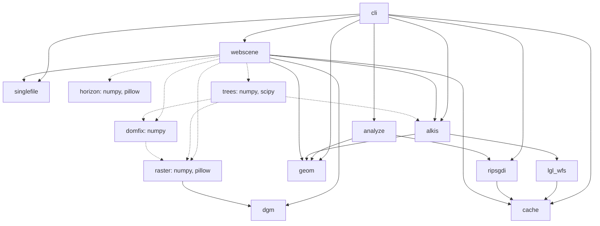

# AGENTS.md: design state for coding agents

Terse and checkable. People should read `docs/DESIGN.md` instead.
- Rules (what you must not do): `CLAUDE.md`.
- Rendering facts and measured figures: `docs/RENDERING.md`.
- This file adds: invariants, where to change what, how the export degrades, traps, and what is open.

State: commit `52b8524` plus uncommitted changes of 23.11.2026 (scipy in the `raster` extra; README on DOM1 tiles). Written by Claude (AI assistant) at the request of Daniel Reinhard. If code and this file disagree, the code wins: fix this file.

## Invariants (break one and the output is wrong, not just ugly)

1. **Nothing invented where something real exists.**
   - The aerial image is never upscaled.
   - Trees are only placed at measured DOM1 maxima (`trees.find_tops`), with no jitter.
   - Map zones are mixed into the terrain shader (`withOverlay` in `viewer/viewer.js`), never drawn on the surface blocks.
   - AI detail goes only on the heap, labelled.
2. **The heap is a scenario.**
   - Its inputs come from `sites/<id>_szenario.json` only.
   - No haul ramp, access road or dust.
   - The highest point of the bermed form equals that of the simple form.
3. **Provenance.**
   - Every service call goes through `HttpCache.request(..., validate=...)`. An invalid body is never cached.
   - Every embedded dataset carries its source and retrieval date into `scene.json`, which the viewer lists under "Quellen".
4. **Offline page.** The single file makes no network request. `tools/check_page.py` must print `REQUESTS []`.
5. **Standard library core.**
   - `cache`, `geom`, `ripsgdi`, `lgl_wfs`, `alkis`, `analyze`, `dgm` and `cli` import no numpy, pillow or scipy at module level.
   - `tests/test_raster.py` checks that the CLI loads without `geoanalysis_viewer.raster` or `.trees`.
   - `raster.py` is the only module that imports numpy at top level.
6. **Coordinates.**
   - EPSG:25832, origin = rounded centre of the site's bounding box (`webscene.build`).
   - Bundle: `x = E - ox`, `y = N - oy`. three.js: `(x, height, -y)`.
   - `terrain.bin` and `surface.bin` are uint16 little-endian, in cm above `terrain.z_min`, row 0 = south. `ring.bin` uses decimetres.
7. **True scale.** Eye-level field of view is computed in `eyeFov`; overviews use 45°. If you change it, keep the on-screen note (`scaleNote`, set in `updateFov`) in step.

## Module map

Solid arrows are top-level imports; dotted arrows are imports inside a function, so the optional dependency is only needed when that function runs.



`webscene` imports `singlefile` only to re-export `embedded` and `single_html`. Nothing in this repository uses that re-export, so it can go.

## Where to change what

| Change | File | Watch out |
|---|---|---|
| A new command | `geoanalysis_viewer/cli.py`: one `cmd_<name>(a, cache)` plus one `command(...)` call in `_parser()` | `--site` is added by `command()`. Write reports through `_report`. |
| A new data layer in the bundle | `webscene.collect_layers` reads `data/<ID>/*.geojson`; the status comes from `analyze` | Keep all attributes. Field names differ per rips-gdi layer. |
| A new LGL WFS query | `lgl_wfs.query(cache, url, typename, bbox)`; `alkis.query` wraps it for ALKIS | The server answers bad requests with HTTP 200 HTML. The validator `is_feature_collection` handles that. |
| A new raster source | `dgm.TILE_URLS` and `raster.KINDS` | Both products share the 2 km zip tiling (`dgm.zip_block`). Downloads are logged in `<tile_dir>/abruf.json`. |
| A surface-model error | Add an entry to `data/reference/dom_corrections.json`, with evidence | `domfix` reads it, both for the 5-m blocks (`fix_grid`) and for the tree tops (`error_mask`). |
| Viewer behaviour | `viewer/viewer.js` (find the section comments `// ---------- ... ----------`) | Never edit `exports/`. Viewer text is German. |
| Heap material | The GPU shader `BAKE_FS` and its CPU twin `bakeMaterial` | Change both, then run `viewer.bakeCompare()` in the console. It must stay within 1/255. |
| Packing of the single file | `geoanalysis_viewer/singlefile.py` | See the traps below. |
| Heap assumptions | `sites/<id>_szenario.json` | Each value needs a source or an "assumption" label. |
| Demo page (GitHub Pages) | `tools/build_demo.py exports/G2_web` writes `docs/g2.html`; `docs/index.html` is the hand-written project page that links it | It must not contain LUBW layers (check: the embedded `scene.json` has no `lubw`). Every rebuild adds about 5.4 MB to history, so rebuild only for visible changes. `docs/.nojekyll` keeps Pages from processing the folder. |

## Degradation

Checked 23.11.2026. The numpy, scipy and pillow rows: `export-web --offline` run with the module blocked in `sys.modules`. The other rows were read in the code.

| Missing | Effect | Where |
|---|---|---|
| numpy | `fetch`, `analyze`, `settlement` and `export-web` without flags work. The horizon ring is skipped. `--surface` and `--single` raise `ImportError`. | `webscene.build` catches `ImportError` only around `horizon` and `trees` |
| scipy | **Trees are skipped silently.** Surface blocks stay. | `webscene.build`, `except ImportError` around `trees.build` |
| pillow | The single file keeps the JPEGs (no WebP or AVIF). The horizon ring is skipped. `--detail-mpp` raises `ImportError`. `--surface` fails in `raster.read_tile`, unless the resampled grid is already in `grid_cache/`. | `singlefile._webp`/`_avif` return `None` |
| DOM1 tiles in `data/sources/dom/opendata/` | `surface_heights` returns `None`: bare terrain, no blocks, no trees. **No command downloads them.** | `webscene.surface_heights` |
| Copernicus tile `horizon.COP_FILE` in `data/sources/copdem/` | No horizon ring | `horizon.build_ring` |
| DGM1 tile with `--offline` | `FileNotFoundError`, which names the URL | `dgm.ensure_zip` |
| A cache entry with `--offline` | `CacheMiss` aborts the command. Exception: the ALKIS buildings for the tree mask, where the trees are skipped instead. | `cache.HttpCache.request`, `trees.building_mask` |
| AVIF in the browser | The 1-m image and the plain ring stay; a console warning is printed | `loadDetail`, `loadRingImage` in `viewer.js` |
| GPU bake shader fails to compile | The CPU bake takes over. `?bake=cpu` forces it. | `BAKE_GPU` in `viewer.js` |

## Traps

- **The packer swaps exact strings.**
  - `singlefile.single_html` replaces these:
    - `from "three"` and `from "three/addons/controls/OrbitControls.js"` in `viewer.js` (double quotes);
    - `'./three.core.js'` in `three.module.js`;
    - `from 'three'` in `OrbitControls.js`;
    - the `<script type="importmap">` in `viewer/index.html` (found with `str.index`).
  - If a string is missing, it raises `RuntimeError`; a missing import map raises `ValueError`. Changing quote style or adding a third import in `viewer.js` breaks the single file.
- **Rerunning `export-web` into the same folder** deletes stale `trees.bin`, `canopy_class.bin`, `ring.bin`, `ortho_detail.jpg` and `ringimg_*.jpg` first. A new optional output needs the same cleanup.
- **`raster.load` caches resampled grids** in `data/sources/<kind>/grid_cache/`. Delete them after changing tiles by hand.
- **Line endings.** The working copy may be CRLF on Windows; the index is LF (`.gitattributes`: `* text=auto`). Write files with the line ending already in the file.
- **Page check.** `tools/check_page.py` needs a windowed Chrome; a headless one stays at "loading". Use `file://` URLs only. Set `CHROME` if Chrome is installed elsewhere.
- **Windows console.** `cli.main` reconfigures stdout and stderr to UTF-8. Keep that, because the reports are German.
- **Server quirks.** See `CLAUDE.md` (rips-gdi `distance=0`; the LGL WFS answers with HTTP 200 "Request Rejected").

## Verify

```powershell
python -m unittest discover -s tests -q                     # 54 tests, offline
python -m geoanalysis_viewer --offline export-web --site sites/g2.geojson --surface --detail-mpp 0.2 --single
python -I tools/check_page.py file:///<repo>/exports/G2_3d.html   # STATE viewer true, REQUESTS [], no EXCEPTION
```

The last stderr line of a command, `[cache] hits=… network=…`, must show `network=0` on an offline rerun.

## Decisions already taken (don't reopen without a reason)

- **One static HTML file, no server.** Rejected: online 3D tiles, because their terms forbid offline storage.
- **base-122 instead of base64.** It is 14 % smaller from disk and about 4 % larger over HTTP with gzip. Disk and attachment are the target.
- **`viewer.js` stays one file**, because the packer fills exactly two import specifiers.
- **Two heap bakes (GPU and CPU)**, on purpose: reference and fallback.
- **DOM1 errors are corrected from a documented list**, not by a general filter.
- **GPL-3.0-only.** Third-party notices are in `THIRD_PARTY.md`.

## Open

1. **No DOM1 download.** Pass `download` from `cmd_export_web` (`not a.offline`) through `webscene.surface_heights` and `trees.build` to `raster.load("dom", ...)`. `surface_heights` currently picks complete 2 km blocks from the files on disk, so this needs a different tile selection.
2. **A fresh-clone build with network access is unverified.** Run it before claiming the README steps work.
3. **Tested on Python 3.14 / Windows and one desktop GPU only.**
4. **Small leftovers:**
   - the `cache.py` docstring names LGRB and Overpass, which this repository does not use;
   - `singlefile.py` cites a `RENDERING.md` section "Encoding" that does not exist;
   - the `webscene` re-export of `singlefile`.
5. **Not done**, by choice or for lack of data: see `docs/RENDERING.md`, "Not done".
