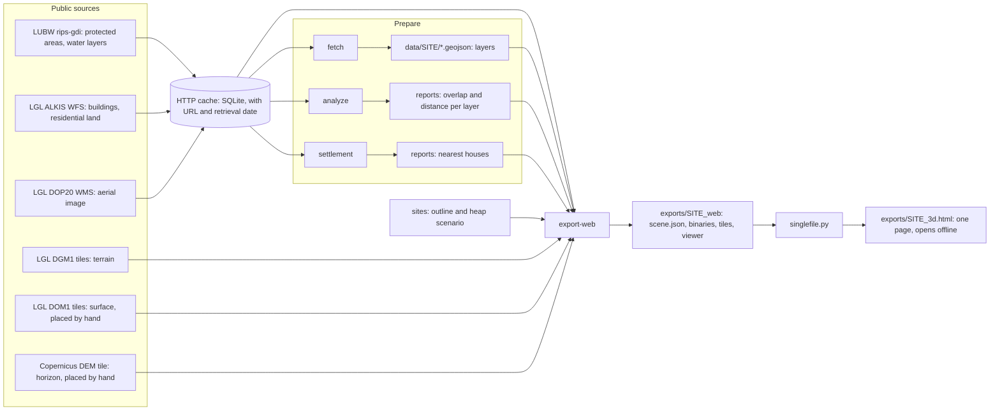
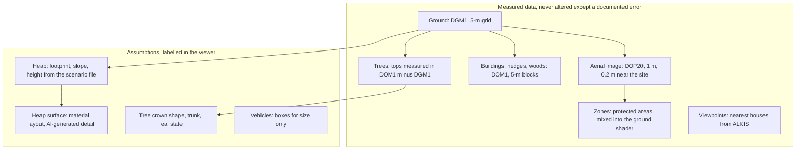
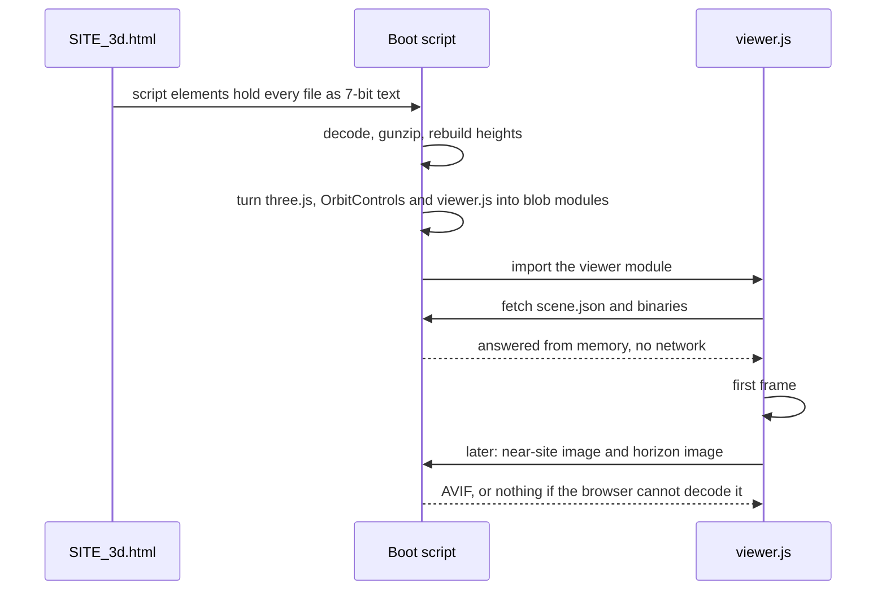
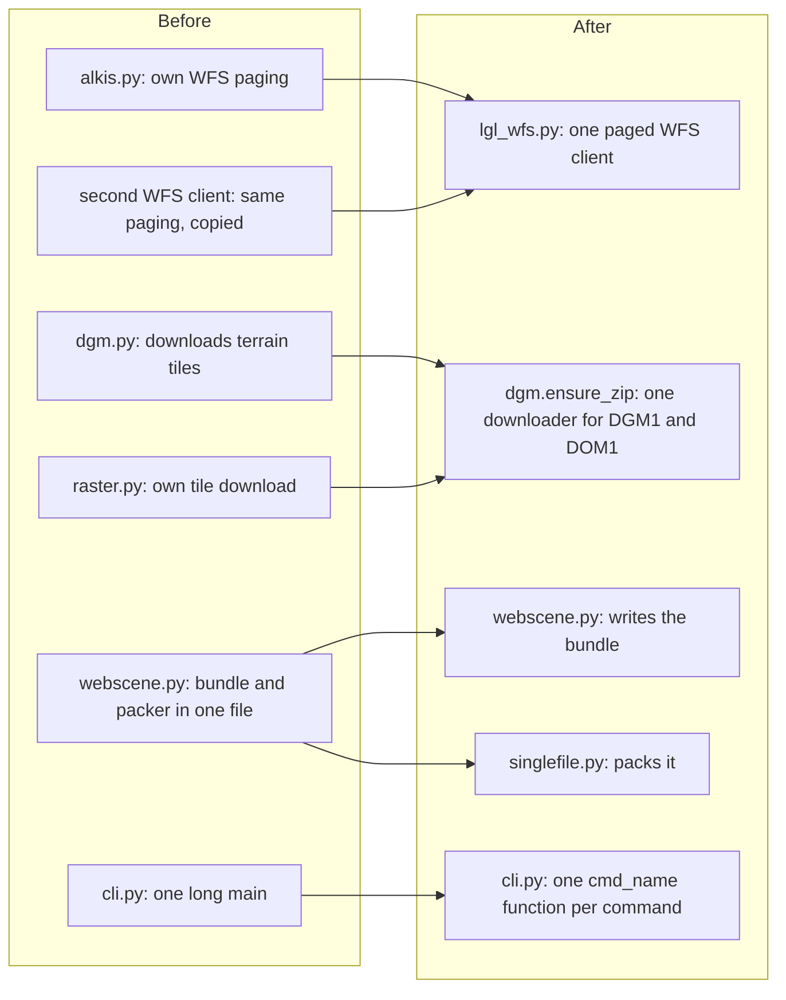

# Design: why the viewer is built the way it is

This document is for people who want to understand, judge or change geoanalysis-viewer. It explains the decisions behind the code, what each one costs, and what is still open. For build commands see `README.md`. For the rendering details and measured figures see `docs/RENDERING.md`. Coding agents have a terser version in `AGENTS.md`.

State described: commit `52b8524` plus the local changes of 23.11.2026 (scipy added to the `raster` extra, README corrected on DOM1 tiles). Written by Claude (AI assistant) at the request of Daniel Reinhard, from the code and its comments. Where the reason for a choice was never written down, this document says so instead of guessing.

## The problem

A landfill is planned somewhere in a search area. People living nearby ask a simple question: *what would I see from my window?* Answering it honestly takes three things at once:

- **real ground, buildings and trees**, because they hide or reveal the heap;
- **a heap whose size follows stated assumptions**, because no plan exists yet;
- **a view at the angle a person would actually see**, not a dramatic wide angle.

The viewer builds exactly this from public geodata. Everything else follows from one principle and one rule.

**Principle: the weakest link limits the picture.** Image detail, ground shape, light and lines each need enough quality. A sharp aerial image on a coarse ground looks wrong, and so does a fine ground under a blurry image. Effort goes where the weakest link is (`docs/RENDERING.md`, "First principles").

**Rule: nothing invented where something real exists.** The aerial image is never upscaled. No houses or trees are made up. Synthetic or AI-generated detail appears only on the heap, which is an assumption anyway, and the viewer labels it there.

## How data becomes a page

Four commands, run in order:

1. `fetch` gets the map layers around the site.
2. `analyze` works out, per layer, whether it overlaps the site or how far away it is. The viewer shows this status when you click a zone.
3. `settlement` finds the nearest houses. They become the eye-level viewpoints.
4. `export-web` puts everything together: the bundle folder and, with `--single`, one HTML file.

## Decisions

Each row: what was chosen, what the alternative was, why, and what it costs. Figures come from `docs/RENDERING.md` and are for G2 on one desktop GPU. A reason marked *(inferred)* is not written down in the code or docs; it is the most plausible reading, not a recorded intent.

### What the page is

| Decision | Alternative | Why | Cost |
|---|---|---|---|
| **One static HTML file** that opens from disk, with no server and no network request. | A web map with a tile server, or online 3D services. | It can be opened from disk or sent as an attachment (`docs/RENDERING.md` measures both cases). *(inferred:)* it can be archived, nobody's visit is logged, and the same file always shows the same thing. | The file is large (5.47 MB for G2). The data are frozen at export time, so updating means exporting again. |
| **Rejected: Google Photorealistic 3D Tiles.** | They would look more realistic. | Their terms forbid offline storage and derived content. | The view is built from official data only, which looks plainer. |
| **A demo page in the repository** (`docs/index.html`, served by GitHub Pages), built by `tools/build_demo.py` without the LUBW layers. | Only build instructions. | People can try the viewer without installing anything. The LUBW layers are left out because their terms for redistribution were not checked. | The demo lacks the protected-area zones. Each rebuild adds about 5.4 MB to the git history. |
| **German in the viewer, English in code and docs.** | One language throughout. | Rule in `CLAUDE.md`. *(inferred:)* the page's audience is local, contributors to the code may not be. | Two languages to keep apart. |

### What is real and what is assumed

| Decision | Alternative | Why | Cost |
|---|---|---|---|
| **Trees are drawn only where a top was measured**, at the measured height and crown radius (`trees.py`). | Scatter trees over wooded areas, or keep everything as boxes. | Boxes make a wood look like a wall. Scattered trees would be invented. | Dense woods show fewer trees than there are. The survey flight was in March (leaf-off), but the crowns are drawn closed. |
| **Surface errors are corrected from a documented list** (`data/reference/dom_corrections.json`, `domfix.py`). | Filter every implausible height automatically. | The known error (a steam plume matched as a solid body up to 154 m high) is recorded with its evidence, and the stack beside it is kept. *(inferred:)* a general filter could remove real tall structures unnoticed. | Each new error has to be found and recorded by hand. |
| **Map zones are mixed into the ground shader**, never draped over the tree and building surface. | Lay the zones on top of everything. | Rule in `CLAUDE.md`. *(inferred:)* a zone on a roof or treetop would show it as part of the area. Recorded: zone fills fade at a grazing angle, so the land shows through at eye level. | More shader code. |
| **The heap comes from a scenario file** (`sites/<id>_szenario.json`). Every value is either sourced or marked as an assumption. | Values typed into the code. | The assumptions can be read, checked and argued about without reading code. | None worth naming. |
| **AI-generated detail only on the heap**, labelled under "Oberfläche" and "Quellen". | No AI detail, or AI upscaling of the aerial image. | Rule in `CLAUDE.md` ("nothing invented where something real exists"). *(inferred:)* the heap has no real image to show, so detail there invents nothing that exists. | It depends on a model licence (`THIRD_PARTY.md`). |
| **No haul ramp, access road or dust plumes.** | Show a working site with traffic. | Any access drawn would suggest where the access will be, and that is not known. | The operating state looks tidier than a real one would. |

### What the eye sees

| Decision | Alternative | Why | Cost |
|---|---|---|---|
| **True angular size at eye level.** The vertical field of view is set for an assumed screen (50 cm away, 0.26 mm per CSS pixel), about 22° instead of the usual 45°. | The standard 45° field of view. | 45° shrinks distant objects, so the heap would look smaller than a person standing there sees it. | The browser cannot know the real pixel size, so the viewer states its assumption (zoom 100 %). Overviews keep 45°. |
| **"Photo-preserving" light**: flat ground keeps the aerial image's brightness, and only slopes get lighter or darker. The sun direction is the one on the flight day, measured from tree shadows (`tools/sun_from_shadows.py`). | Ordinary 3D lighting with shadows. | The aerial image already contains the shadows of its flight day. A second light would cast a second, different set. | No free time-of-day lighting. |

### Making it small and fast

| Decision | Alternative | Why | Cost / measured |
|---|---|---|---|
| **Ground mesh thinned (RTIN)**: a triangle stays large as long as the grid deviates from it by at most 0.15 m, the stated accuracy of DGM1. | Draw the full grid. | It removes triangles that add no information. | 1.16 M → 0.35 M triangles for the ground. Heights read elsewhere can differ from the drawn surface by up to 0.15 m. |
| **Heap material map rendered on the GPU** once per change, with the CPU version kept as reference and fallback. | CPU only, or GPU only. | The map is rebuilt on every slider change (speed figures are not recorded). The CPU path checks the GPU result (`viewer.bakeCompare()`, at most 1/255 per channel) and steps in where the shader fails to compile. | Two implementations of the same map must be kept in step. |
| **Packing: base-122 text** instead of base64 inside the HTML. | base64, the usual choice. | It is smaller when the file is opened from disk or sent as an attachment. | 14 % smaller from disk. About 4 % *larger* when served over HTTP with gzip. A custom decoder. |
| **Images as WebP; the optional near-site and horizon images as AVIF.** Heights are stored as decimetre row differences (rounding ≤ 5 cm, below the DGM1 accuracy). | JPEG and raw heights. | Smaller at equal error. Both AVIF images are optional: a browser without AVIF keeps the 1-m image. | The packer needs numpy and pillow. |

### How the single file starts

`viewer.js` is the same file in the folder version and in the single file. The packer only fills in its two import specifiers (`singlefile.py`).

### How the code is organised

| Decision | Alternative | Why | Cost |
|---|---|---|---|
| **Data clients, cache and geometry use the Python standard library only.** numpy, pillow and scipy are imported inside the functions that need them. | numpy everywhere. | Written down only as a rule, with a test that the CLI loads without numpy. The effect: `fetch`, `analyze` and `settlement` run on a bare Python. | Each heavy import sits inside a function, which is easy to get wrong. |
| **Every network request goes through one SQLite cache** that stores URL, parameters and retrieval date, and checks each answer before storing it (`cache.py`). | Plain requests. | Every figure in the viewer must name its source and date. Runs repeat offline (`--offline`). Some servers answer errors with HTTP 200 and an error page, and those must never be cached. | Data go stale until `--refresh`. |
| **One coordinate system (EPSG:25832)**, with a local origin at the site centre. three.js gets `(x, height, -y)`. | Geographic coordinates. | *(inferred:)* metres everywhere, and small coordinates keep GPU float precision. | Only valid in UTM zone 32. |
| **`viewer.js` stays one file** of about 1,950 lines. | ES modules per topic. | The packer fills exactly two import specifiers. Splitting would touch every part of the viewer with no change in behaviour. | It is a long file to find your way around. Its section comments (`// ---------- terrain mesh ----------` and so on) are the map. |

## What the clean-up changed

Before publication the code was cut out of a larger, unpublished analysis toolkit by the same author. It was cleaned up with one test: **the outputs must not change**. All offline commands of the toolkit were rerun before and after; reports and bundles were identical apart from timestamps.

Improvements:

- **Duplication removed.** There is one WFS client (`lgl_wfs.py`) and one tile downloader (`dgm.ensure_zip`), and the packer is separate from the bundle writer (`singlefile.py`).
- **Two bugs fixed.**
  - Printing a German report crashed with `UnicodeEncodeError` when output was redirected to a file on Windows. stdout and stderr are now UTF-8.
  - The second bug was in a command that is not part of this repository.
- **A leftover shim removed.** The opacity slider now sets the shader value directly.
- **Packaging.**
  - `pyproject.toml` has a `raster` extra.
  - `.gitattributes` sets one line-ending rule.
  - The licence is GPL-3.0.
- **Self-contained.**
  - The package is `geoanalysis_viewer`, with no import from the larger toolkit.
  - Only what the four commands need was kept.
  - `analyze` and `settlement` stayed because the viewer shows their results.

What the extraction left behind (see "Open"):

- The larger toolkit had a command that downloaded the DOM1 tiles. It did not come along.
- scipy was declared in a different extra. It has now been added to `raster`.

## Open

- **DOM1 tiles are not downloaded by any command.** `--surface` reads them from `data/sources/dom/opendata/`. Without them the page shows bare terrain. Fixing it means passing `download` through to `raster.load("dom", ...)` and choosing tiles by the site box instead of by the files on disk (`AGENTS.md`, "Open").
- **A fresh clone has not been built end to end with network access.** The checks before publication ran from an existing cache.
- **Tested only with Python 3.14 on Windows**, and measured only on one desktop GPU. Laptops and phones have not been measured.
- **Not done** (`docs/RENDERING.md`, "Not done"):
  - LoD2 building models;
  - a summer surface model;
  - ambient occlusion;
  - GPU texture compression.
- **Small leftovers:**
  - `cache.py` mentions services this repository does not use;
  - `singlefile.py` cites an "Encoding" section that `RENDERING.md` does not have;
  - `webscene.py` still re-exports the packer's functions, though nothing here imports them from it.
